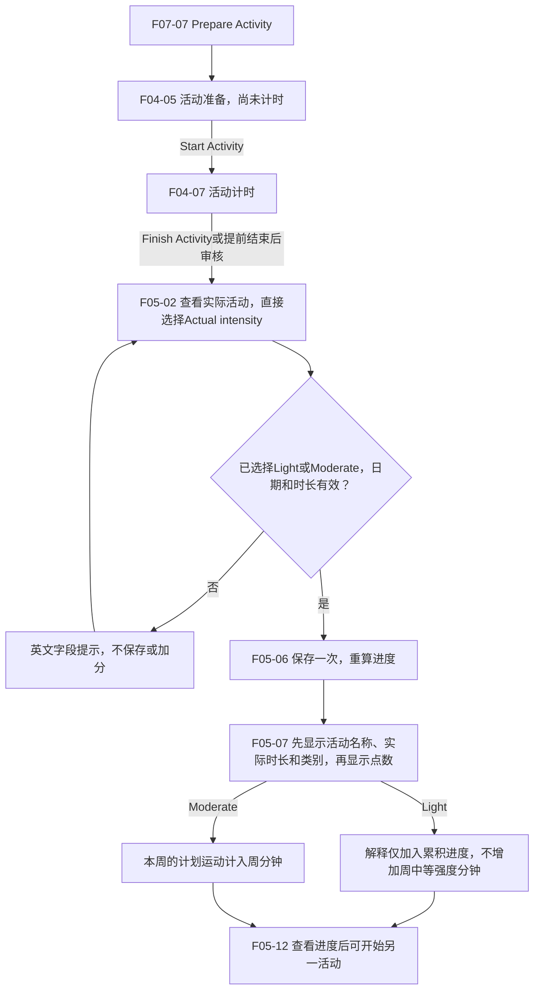
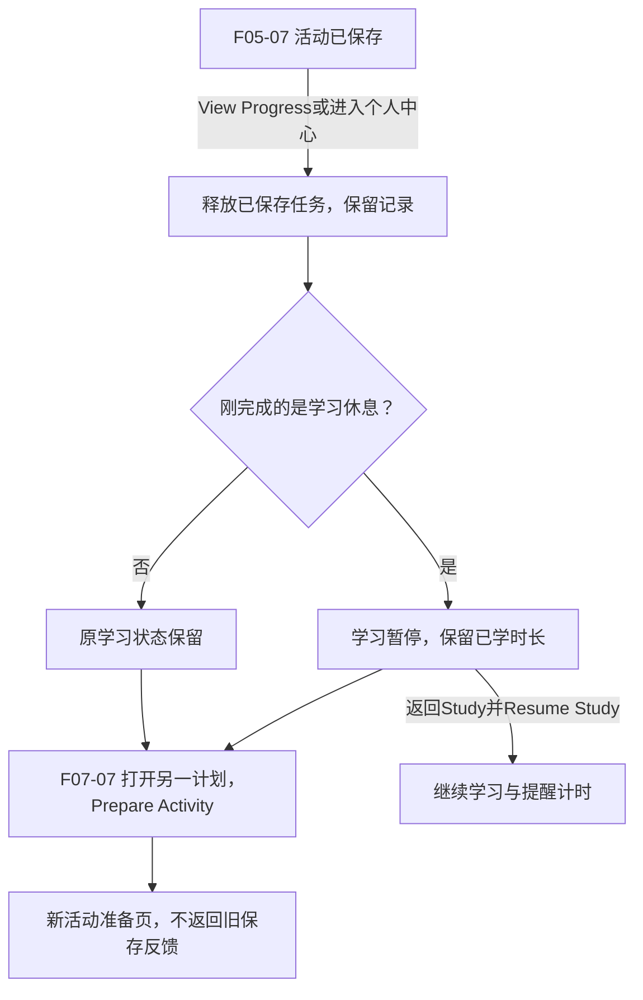
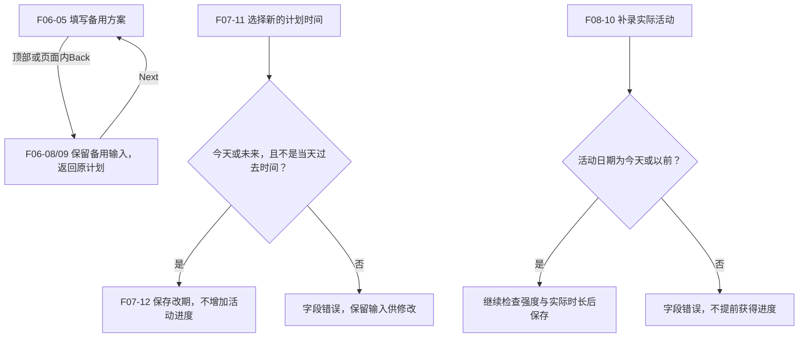

# V2 当前流程变化｜2026-11-20

以下内容对应本地已实现的v2。完整v1图保留在 `user-flow-baseline-zh.md`，用于前后对照；同一编号表示同一用户任务或操作位置。

## 本轮变更位置

| 流程位置 | V2行为 | 组员复查 |
|---|---|---|
| F01-07 | 首页未开始学习时使用Open Study Session | 点击进入学习页，再明确开始计时 |
| F03-05 | 提醒使用Prepare Break | 进入活动准备页后计时仍为0 |
| F04-03 / F05-12 | 已保存活动离开反馈后释放任务，休息后的学习暂停 | 查看进度后可以开始新运动 |
| F05-02/03 | 计划运动在确认页直接必选Actual intensity | 不选不能保存；Light/Moderate按选择统计 |
| F05-07 | 保存反馈先展示活动名称、实际时长和类别 | 轻量运动有说明；宠物关闭不显示Stage |
| F06-09 | 顶部与底部Back都保留备用输入 | 往返上一步后输入一致 |
| F07-07 | 计划详情使用Prepare Activity | 进入准备页，Start Activity才开始计时 |
| F07-11/12 | 改期不能在过去；新建/编辑计划也检查日期时间 | 过去日期和当天过去时间均有错误提示 |
| F08-10/11 | 实际补录不能填未来日期；运动强度必须明确选择 | 不合法值不会增加记录或积分 |
| F09-03 | 本阶段已积累与升级剩余明确分开 | 38总分时显示8/30和剩余22 |
| F10-06 | 当前生效目标不因下一预约回退 | 生效90后再预约120，当前仍90 |

## 计划运动的确认与保存

## 保存后衔接下一项任务

## 返回与日期限制

来源：当前源码、22项自动测试及本轮开发者浏览器走查。课堂反馈、真实手机及完整无障碍验证仍待补充。
