# Lo-fi v2 协作说明与用户流程（中文版）

基线：2026-11-20，`Valen_branch`，产品代码提交 `c22e7a8`。这是当前 v1 的实际行为基线，用于后续 v2 变更对照；不是拟议修复后的理想流程。没有新增功能、真实用户研究或修改产品代码。

## 协作背景与分工

本次工作基于共同仓库中已有的 v1 原型，在 `Valen_branch` 上完成 lo-fi v2 作业的修改。分支提交后，组员检查更新内容并进行用户任务走查，再按小组约定合并。

代码审查由负责的组员及其 agent 完成。用户任务走查主要检查流程是否连贯、操作结果是否符合预期，以及活动记录和进度是否一致。组员优先检查本次修改涉及的任务，并完整体验一次学习休息和计划运动流程；61项详细检查作为进一步排查的参考。

下方流程图记录修改前的 v1；任务表列出预期结果，其中部分仍对应已知问题。v2实施后，更新说明将列出实际改动和重点复查任务。

## 主要走查任务

获取 `Valen_branch` 的最新代码并启动本地网页，确认当前分支和提交版本。走查可使用示例数据或自建测试记录；重置前确认本地数据可以清除。环境准备可交由各自的 agent 完成。

| 用户任务 | 操作步骤 | 预期结果 |
|---|---|---|
| 1. 完成首次设置 | 设置学习和运动偏好，选择是否显示宠物，点击 Save & Continue | 进入首页；再次打开时保留设置 |
| 2. 完成学习休息 | 首页 → Study → Start Studying；展开 Prototype time controls → Simulate Next Reminder → Start Break → Start Activity → Finish Activity → Save Activity | 提醒、活动和确认页面衔接正常；保存后才计入休息记录 |
| 3. 延后休息提醒 | 提醒出现时选择 Remind Later，再选5或10分钟 | 返回学习页并显示新的提醒时间；延后操作不计为活动 |
| 4. 暂停与恢复 | 分别操作 Pause Study／Resume Study 和 Pause Reminders／Resume Reminders | 暂停学习会停止学习计时；仅暂停提醒时学习计时继续 |
| 5. 创建运动计划 | Exercise → Create Exercise Plan → 填写活动和时间 → Next → 填写备用活动 → Save Plan | 计划保存并显示在列表中；创建计划不增加运动分钟 |
| 6. 返回修改备用方案 | 填写备用活动后返回上一步，再点击 Next；分别检查顶部和页面内的 Back | 两种返回方式均保留已输入内容 |
| 7. 调整受阻的运动计划 | 计划详情 → I Can't Do This Now；分别操作 Use Backup、Reschedule，以及取消或确认 Skip | 备用活动可以执行；改期更新计划时间；跳过不扣除历史进度，也不计为完成 |
| 8. 连续完成不同活动 | 保存活动 → View Progress → 进入另一项运动并开始 | 正常进入新活动，不返回上一条活动的保存页面 |
| 9. 更正活动记录 | Progress → View Activity History → 记录 → Edit → 修改时长 → Save；另检查取消编辑 | 统计按更正后的记录更新，无重复计分；取消保留原记录 |
| 10. 检查日期限制 | 补录实际活动时选择未来日期；运动改期时选择过去时间 | 未来活动不计为已完成；过去的计划时间有明确提示或限制 |
| 11. 查看进度与切换宠物 | 查看两类活动的进度；在宠物页关闭后重新开启 | 两类活动分别统计，数字含义明确；宠物开关不影响记录和累计进度 |
| 12. 调整目标与检查导航 | 调整周目标，检查其生效时间；检查页面返回、取消与切换 | 目标按所选时间生效；操作无阻断、意外输入丢失或结果不一致 |

走查范围以本次修改为主，并保留两条核心流程的完整检查。可使用模拟时间控件缩短等待；模拟操作仅用于检查原型交互，不作为真实活动完成的证据。

## 问题反馈格式

反馈应包含用户任务、操作路径、实际结果和预期结果。必要时附截图，便于复现和定位。

```text
用户任务：保存休息后开始另一项运动。
操作路径：Save Activity → View Progress → Exercise → 计划详情 → Start Activity。
实际结果：返回上一条活动的保存页面。
预期结果：进入所选运动。
截图及补充：……
```

## 变更说明格式

变更说明应交代原问题、调整后的行为和复查方式。以下为拟议修复的说明示例，尚未实施：

```text
改动内容：修复已保存活动阻挡下一项活动的问题。
原有行为：保存后查看进度，再开始运动时会返回旧的保存页面。
调整后行为：可以进入新运动，上一条记录保留且只计入一次。
复查路径：保存休息 → 查看进度 → 打开运动计划 → 开始运动。
验证状态：待实施及复查。
```

完整流程图用于核对行为和追踪修改位置。流程编号与详细检查项供记录维护和进一步排查使用；英文技术交接另见 `agent-review-notes-en.md`。

## 流程图阅读说明

- 先看 F00–F01 理解入口，再看 F02–F07 的学习和运动，最后看 F08–F13 的反馈、设置及异常处理。
- 每个节点含稳定编号，如 `F05-08`。后续修改保留原编号，新分支追加编号；不要为了排版重排编号。
- 方框：页面、操作或状态；菱形：条件或选择；双框：调用另一张流程图。红色且写有“问题”的节点表示现状缺陷，不能当作预期验收结果。
- 图按操作与状态变化拆分。同一页面的每个输入字段在说明中列全；共享活动、确认和验证只画一次，通过跨图入口复用。
- 来源为 `src/App.jsx`、`src/model.js`、`src/Form.jsx`、`src/validation.js` 和项目说明。除单独标注的 11/18 audit 复现外，其余分支为源码核对，尚未全部重新进行浏览器验证。
- 应用界面保留英文；这里用中文解释，关键按钮附英文便于定位。`P01–P15` 为原页面编号，`Fxx` 为流程编号，`Txx.yy` 为走查用例。

## F00｜首次进入、初始化与设置

入口：第一次打开网站，或明确重置后。输出：保存偏好并进入首页。没有注册、登录、真实设备授权。

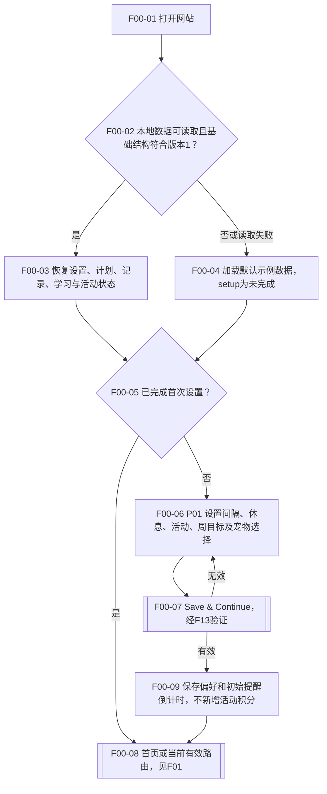

字段：学习间隔1–180分钟；休息1–60分钟；活动四选一（Short walk／Stretching／Walk to get water／Gentle movement）；周目标1–3000分钟；宠物必须明确选 Yes 或 No。默认45分钟学习、3分钟休息、60分钟周目标均为原型设定。默认示例为3分钟休息、20分钟中等强度运动和一项待执行计划；Empty Reset 则没有这些示例。手动访问 `/setup` 仍会显示设置表单，并要求重新选择宠物。

## F01｜首页入口与全局导航

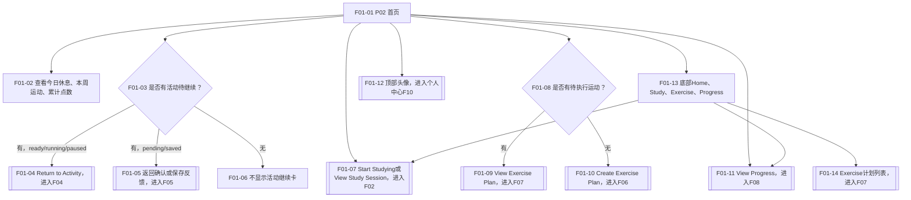

说明：首页 Start Studying 当前只导航到学习页，仍需再次按 Start Studying。待执行计划按日期和时间排序，包含 Planned、Rescheduled、In Progress；没有独立逾期分组。今日没有记录时，显示空状态或“之前的进度仍保留”。Setup、Activity、Confirmation 隐藏底部导航；活动页头像不会直接打开个人中心，见F12。

## F02｜学习设置、开始、暂停、继续与结束

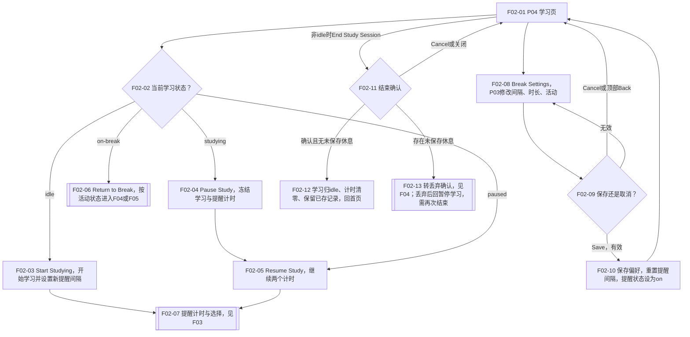

注意：学习暂停与提醒暂停不同。编辑设置后保存会重新开启本次提醒状态并重置间隔；全局通知开关仍单独生效。学习计时按前台 interval 增加，不补算关闭页面或后台节流的真实经过时间。已有其他类型活动时，结束学习不会自动删除那项活动。

## F03｜休息提醒、延后、暂停与恢复提醒

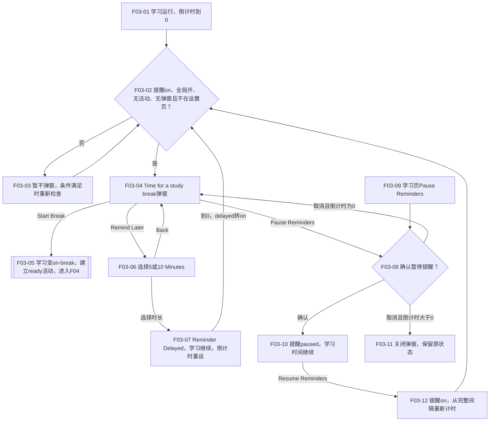

提醒、延后选择、提醒暂停确认没有关闭X，也不响应 Escape；必须选择提供的动作。全局关闭提醒见F10。模拟提醒见F11，不计活动分数。自然提醒是全局效果，在首页、运动或进度等页面也可能出现，不限学习页；其他弹窗或活动存在时暂不出现。

## F04｜共用活动：准备、计时、暂停、提前结束与丢弃

入口：学习提醒、原计划或备用活动。输出：转确认，或不保存退出。

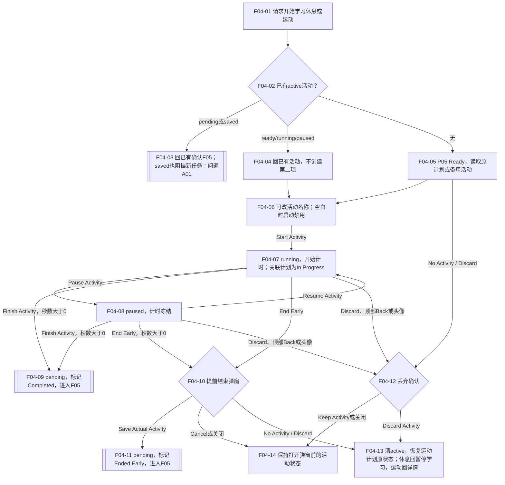

补充：返回既有活动、取消提前结束、Keep Activity均保留原ready/running/paused状态，不强制开始运行。弹窗本身不暂停计时。秒数0时 Finish／End Early 禁用；Finish 不检查是否达到计划时长。实际时长建议至少0.1分钟，用户稍后可更正；强度由名称关键词默认猜测（A04），并非传感检测。丢弃不产生记录或积分。

## F05｜实际确认、编辑、保存与离开反馈

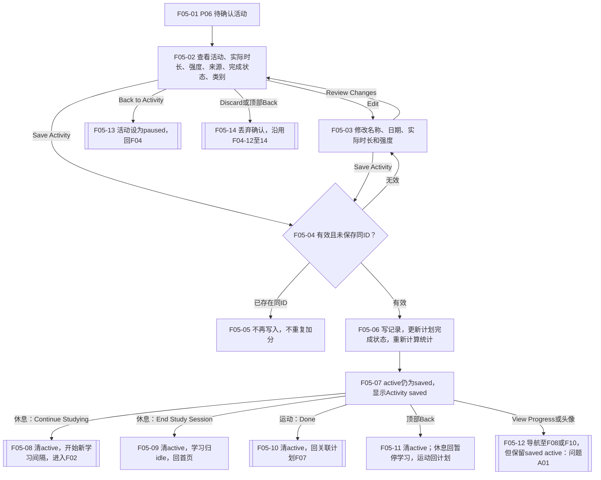

日期目前允许未来值（A02）；编辑活动名称不会重新推断强度。只更改未保存表单不会增加记录；类别在此确认页不可更改，来源固定 Self-reported。积分＝已存实际分钟；同ID替换而非叠加。编辑模式的 Review Changes 只切换显示，不相当于正式保存。

## F06｜创建、填写备用、返回与编辑运动计划

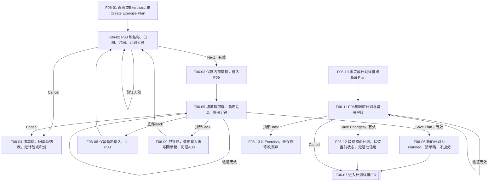

字段：活动名必填且不全空格，最多70字符；日期、时间必填；计划和备用时长1–600整数分钟；障碍最多180字符，可不填。日期目前不限制过去（A06）。新计划默认 Brisk walk、今天17:30、20分钟、Indoor stretching 10分钟；没有强度输入。P08顶部Back回Exercise但不明确清除先前内存草稿；P09刷新丢草稿并显示先创建计划（见F12）。完成、提前结束、跳过的计划详情不再显示编辑或再次启动按钮。

## F07｜查看、执行、备用、改期、跳过与计划状态

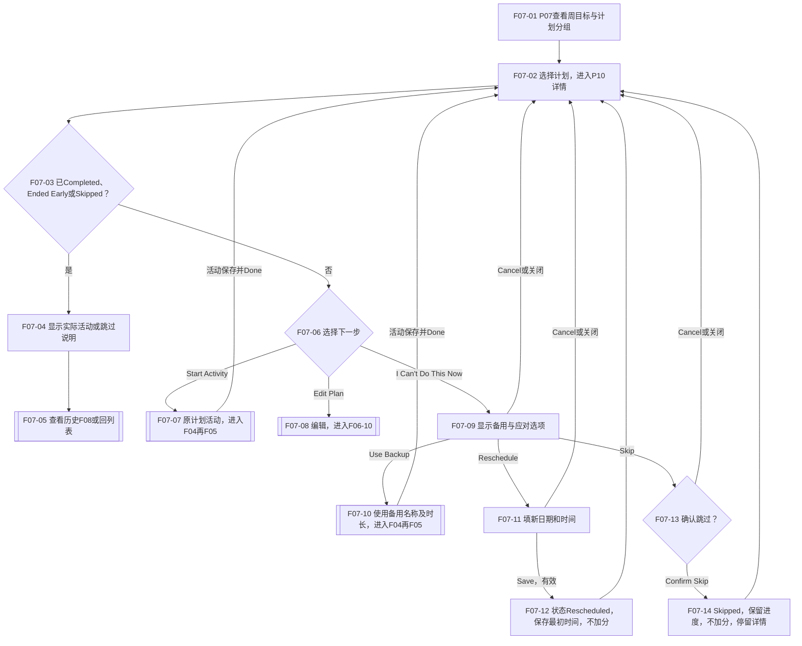

列表分组：Planned 与 In Progress 同组；Rescheduled；Completed 与 Ended Early 同组；Skipped。开始活动计时才设为In Progress；丢弃未保存活动恢复此前计划状态。备用完成显示实际活动的 Backup 标签，但顶层仍叫Completed。改期与跳过都不计完成运动；轻量备用仅贡献累计点数，不计中等强度周分钟。更正关联活动可同步计划完成状态。当前改期允许过去时间（A06），只保存第一次原定时间而非完整历次改期日志。

## F08｜进度、历史筛选、详情、纠错与手动补录

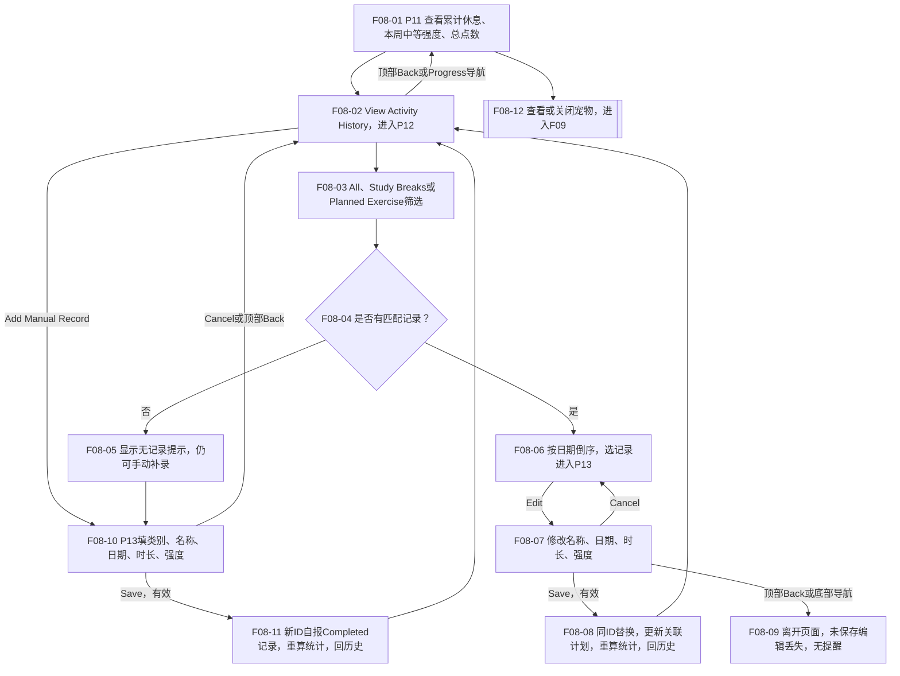

统计规则：休息次数和分钟为所有日期累计；首页休息为当天；周运动只含本周一至周日、exercise类别且Moderate的记录；所有已存记录时长汇总成成长点数。历史无日期范围搜索、无记录删除、无实际完成时间排序。手动补录与更正的日期目前可填未来，立即影响点数与同周分钟（A02）；完整表单验证见F13。更正已有记录时不可切换类别，手动新增时可以。

## F09｜宠物启用、关闭、成长与普通反馈

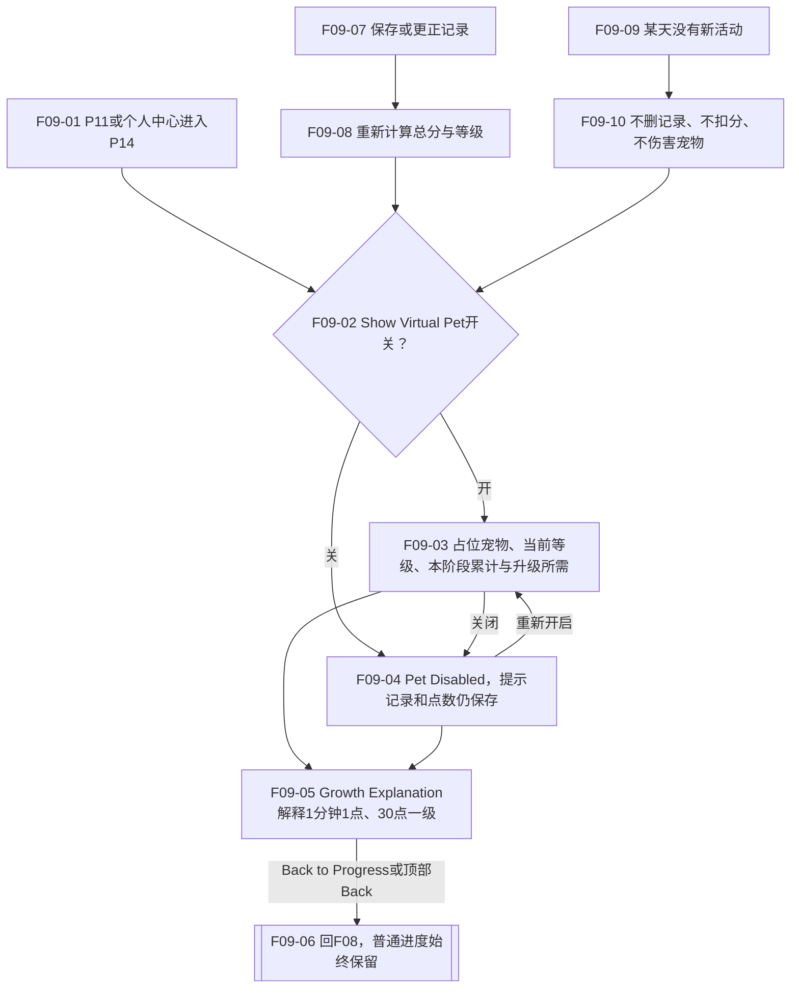

当前图形不会因等级改变而出现不同成长外观，没有动画、装饰或解锁账本。更正记录可能降低累计分与等级；这是数据更正，不是漏做惩罚。进度条把阶段累计称为 points to next stage，与实际剩余值含义不符（A07）。

## F10｜个人资料、每周目标与全局偏好

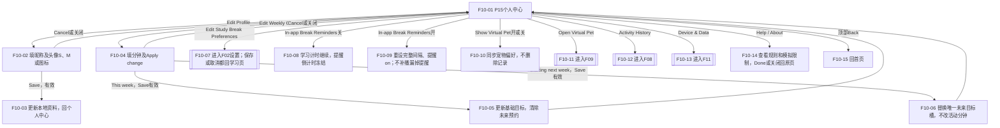

资料昵称必填且不全空格，最多30字符；周目标1–3000整数分钟，默认下周生效。设置预约时不会增加活动或点数。已生效预约被下一预约替换后，当前目标可能回退（A05，模型复现）。资料、目标弹窗取消不保存；开关则立即保存，没有单独Save。提醒开关不等于系统推送授权。

## F11｜课堂演示、设备说明、模拟时间与数据重置

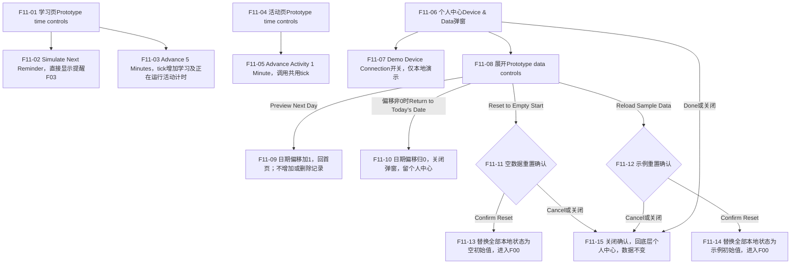

限制：模拟提醒仅学习运行、提醒未paused、全局通知开时可用；学习Advance 5 Minutes仅学习运行时可用；活动Advance 1 Minute仅活动running时可用。它们调用同一个tick；若学习和运动同时running，两个计时会一起推进。模拟计时本身不加分，但之后保存的建议时长可来自模拟，测试者应标记为演示数据。重置替换所有记录和设置，不可当成关闭宠物测试；只在明确的测试数据中使用。

## F12｜顶部返回、离开、刷新与缺少前置数据

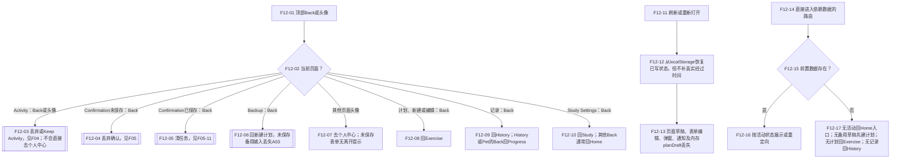

应用顶部Back是固定目标导航，不是浏览器历史后退。浏览器Back没有统一未保存拦截，应单独走查；不能假设和顶部Back相同。`/activity`遇pending/saved自动转`/confirm`；`/confirm`遇ready/running/paused自动转`/activity`。未知路由在setup已完成时回首页，未完成时去setup。已有状态持久化为尽力保存；写入失败会显示“Keep this tab open”，没有云端备份。损坏但通过浅层版本检查的数据可能仍出错，未全面防护。

## F13｜共享表单验证与弹窗关闭规则

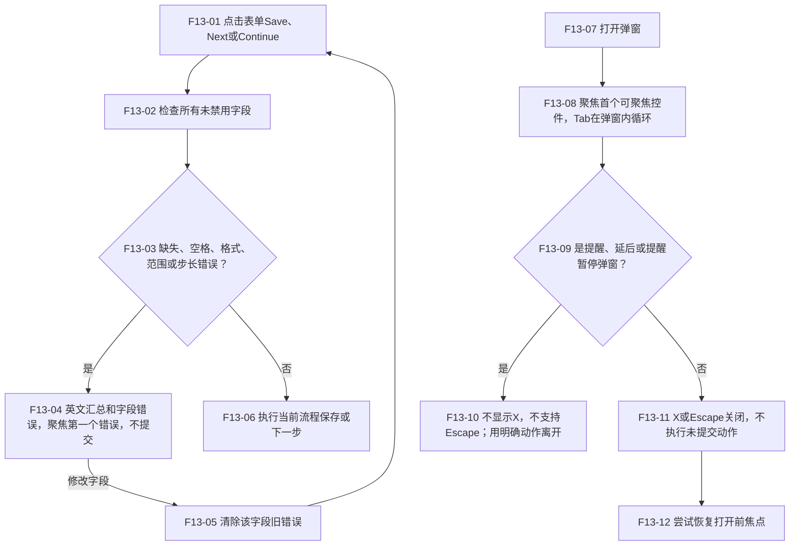

数值限制见各图；英文错误来自共享验证，不使用系统本地化的验证气泡。日期有效不等于业务时间合理：过去改期、未来已完成活动目前都能通过（A02/A06）。开关等立即写入的动作，在关闭弹窗时不会被撤销。弹窗关闭不是“返回上一级弹窗”：例如取消改期直接回计划详情。

## 详细检查清单（扩展参考）

执行前记录：代码提交／日期／浏览器与视口／空数据或示例数据／测试者。以下全部为待执行用例，不把空表当作已通过。实际结果建议填 `通过 / 失败 / 未测 / 被已知问题阻挡`，并附截图、实际值或观察。已知问题的当前表现不等于修复验收标准。

| 用例 | 用户任务或分支 | 流程节点 | 检查结果与边界 | 实际结果 |
|---|---|---|---|---|
| T00.01 | 首次完成设置，宠物Yes | F00-06至09 | 偏好保存、进Home；示例不是新活动 | 未测 |
| T00.02 | 宠物No及漏选、数值越界 | F00-06/07、F13 | No可保存；无效值英文报错且不进入Home | 未测 |
| T00.03 | 重开网站及直接访问setup | F00-01至05 | 已存状态恢复；重新setup需明确宠物选择 | 未测 |
| T01.01 | Home、Study、Exercise、Progress和头像导航 | F01-07至14 | 路由和活动状态保留，查看页面不加分 | 未测 |
| T01.02 | 有活动时使用Return to Activity | F01-03至05 | ready/running/paused去活动；pending/saved去确认 | 未测 |
| T01.03 | 无记录或无待执行计划 | F01-02/08 | 空状态有下一步；不虚构活动 | 未测 |
| T02.01 | 开始、Pause Study、Resume Study | F02-03至05 | 两个计时随学习暂停一起冻结，再继续 | 未测 |
| T02.02 | 修改休息设置并保存 | F02-08至10 | 新间隔生效，提醒状态on；不改旧活动记录 | 未测 |
| T02.03 | 修改设置后取消或顶部返回 | F02-09 | 旧设置保留；均回Study | 未测 |
| T02.04 | End Study确认与取消 | F02-11/12 | 确认停止学习，保留已存活动；取消不结束 | 未测 |
| T02.05 | 有未保存休息时结束学习 | F02-13、F04-12 | 当前转丢弃流程，丢弃回暂停状态，需再结束 | 未测 |
| T03.01 | 提醒后立即Start Break | F03-01至05 | 有明确活动，进入Ready，不立即加分 | 未测 |
| T03.02 | 提醒延后5分钟、10分钟、Back | F03-06/07 | 保留学习时长，正确重设延后倒计时 | 未测 |
| T03.03 | 提醒暂停确认、取消、恢复 | F03-08至12 | 学习继续；恢复从新间隔开始；取消分零/非零 | 未测 |
| T03.04 | 在其他页、弹窗或活动期间到提醒时间 | F03-02/03 | 核对全局触发、抑制与再次出现条件 | 未测 |
| T04.01 | 原计划、备用、休息分别开始与暂停 | F04-05至08 | 名称、计划时长、类别、来源正确；不串任务 | 未测 |
| T04.02 | 空活动名、零秒结束、正常Finish | F04-06/09 | 空名禁用启动；零秒禁用结束；Finish到确认 | 未测 |
| T04.03 | End Early保存、丢弃、取消 | F04-10/11/13/14 | 先审核再保存；丢弃无积分；取消保留原状态 | 未测 |
| T04.04 | 顶部Back、头像或Discard后Keep | F04-12至14 | 保留活动；Discard恢复计划旧状态或暂停学习 | 未测 |
| T04.05 | 有active时再请求开始别的活动 | F04-02至04 | 不覆盖未保存活动；saved阻挡为A01回归目标 | 未测 |
| T05.01 | 确认前编辑并Review Changes | F05-02/03 | 名称/日期/时长/强度显示新值，仍未计分 | 未测 |
| T05.02 | Save Activity及重复保存同ID | F05-04至07 | 一条记录一份贡献，不重复累计 | 未测 |
| T05.03 | 已存休息后Continue、End、顶部Back | F05-08/09/11 | 分别进入运行学习、首页idle、暂停学习 | 未测 |
| T05.04 | 已存运动后Done | F05-10 | 回对应计划，active清空，实际摘要更新 | 未测 |
| T05.05 | 已存后View Progress再开始新任务 | F05-12、F04-03 | 当前A01；修复后不应回旧保存反馈 | 未测 |
| T05.06 | 未存时Back to Activity、Discard、顶部Back | F05-13/14 | 返回paused；丢弃需确认；未保存无积分 | 未测 |
| T06.01 | 创建原计划和提前备用并保存 | F06-01至07 | 新计划Planned；障碍可空；不加活动分 | 未测 |
| T06.02 | 备用页底部Back、顶部Back后再次Next | F06-08/09 | 当前顶部返回丢输入A03；应统一保留策略 | 未测 |
| T06.03 | 新建、备用和编辑中Cancel | F06-04/11 | 不创建意外计划；编辑取消保留旧值 | 未测 |
| T06.04 | 修改已有计划并保存 | F06-10至12 | 同一ID替换、保持状态，Home与列表同步 | 未测 |
| T06.05 | 修改草稿后导航或刷新 | F06、F12-11至13 | 记录顶部/底部/浏览器Back及刷新差异 | 未测 |
| T07.01 | 完成原计划或使用备用后完成 | F07-07/10、F04/F05 | 实际内容与原计划分开；备用显示Backup | 未测 |
| T07.02 | 改期保存、取消和无效输入 | F07-11/12 | 日期更新，Rescheduled，无记录或积分 | 未测 |
| T07.03 | 改期到过去日期或当日过去时间 | F07-11/12 | 当前A06；未来修复应阻止或明确逾期语义 | 未测 |
| T07.04 | 跳过确认和取消 | F07-13/14 | Skipped留在详情和列表；旧进度保留 | 未测 |
| T07.05 | 查看四组计划与终态详情 | F07-01至05 | Completed/Ended Early/Skipped无重新启动入口 | 未测 |
| T07.06 | 自定义活动名称与实际强度 | F04-05、F05-02/03 | 当前名称猜测A04；核对周分钟与实际选择 | 未测 |
| T08.01 | 查看进度和三种历史筛选 | F08-01至06 | all-time与本周范围清楚；空结果不丢入口 | 未测 |
| T08.02 | 编辑记录：时长、强度、日期 | F08-07/08 | 同ID替换、重算，关联计划状态一致 | 未测 |
| T08.03 | 编辑Cancel、顶部Back或切Tab | F08-07/09 | Cancel恢复；离开无提示，不误保存 | 未测 |
| T08.04 | 补录休息/轻量运动/中等运动 | F08-10/11 | 只有中等exercise进入周目标，各类可累计点数 | 未测 |
| T08.05 | 补录或更正未来实际记录 | F08、F13 | 当前A02；修复后不提前获得任何进度 | 未测 |
| T09.01 | 从进度与个人中心关闭再打开宠物 | F09-01至06 | 状态同步，记录与普通进度不变 | 未测 |
| T09.02 | 阶段边界29.9、30、38.2及更正 | F09-07/08 | 点数与等级一致；累计/剩余文案A07 | 未测 |
| T09.03 | 没有新活动的一天 | F09-09/10、F11-09 | 没有漏做扣分或宠物惩罚 | 未测 |
| T10.01 | 修改昵称头像，保存/取消/验证 | F10-02/03 | 本地资料同步，取消不保存 | 未测 |
| T10.02 | 目标本周生效、下周预约、取消 | F10-04至06 | 不改活动分钟；本周应用会清未来预约 | 未测 |
| T10.03 | 预约已生效后再安排未来目标 | F10-06 | 当前A05；修复后当前目标不能回退 | 未测 |
| T10.04 | 全局提醒关/开与学习暂停交叉 | F10-08/09、F02/F03 | 学习计时和提醒分别控制；开启不补播 | 未测 |
| T10.05 | 个人中心跳设置/历史/宠物/帮助 | F10-07/11至15 | 当前返回目标清楚，不将Back当历史返回 | 未测 |
| T11.01 | 模拟提醒、推进学习与活动计时 | F11-01至05 | 控件可用条件正确；本身不创建积分 | 未测 |
| T11.02 | 演示设备开关 | F11-06/07 | 不触发真实授权、导入或删除记录 | 未测 |
| T11.03 | 预览下一天及回到今天 | F11-08至10 | 日期改变，数据保留，不自动增加活动 | 未测 |
| T11.04 | 空数据重置：取消及确认 | F11-11/13/15 | 仅确认替换状态，并回Setup | 未测 |
| T11.05 | 重新加载示例：取消及确认 | F11-12/14/15 | 示例替换而非叠加，并回Setup | 未测 |
| T12.01 | 顶部Back与浏览器Back分别测试 | F12-01至10 | 页面目标、草稿、活动状态分别记录 | 未测 |
| T12.02 | 刷新学习/活动/确认/草稿页 | F12-11至13 | 已写状态恢复；不声称补算离线计时 | 未测 |
| T12.03 | 无前置数据直达路由及未知路由 | F12-14至17 | 有提示和返回入口，无白屏或虚假完成 | 未测 |
| T12.04 | 本地保存失败或损坏状态 | F12-12、F00-02 | 标明失败与恢复限制；不得假设完整容错 | 未测 |
| T13.01 | 必填、空格、格式、数值上下限与步长 | F13-01至06 | 英文错误、焦点正确、不误提交 | 未测 |
| T13.02 | 弹窗Tab、Shift+Tab、Escape及X | F13-07至12 | 分别核对三种不可关闭提醒弹窗与其余弹窗 | 未测 |

## 已知问题到流程、用例和代码的映射

| Audit ID | 当前问题 | 流程与用例 | 主要实现位置 | 后续改动状态 |
|---|---|---|---|---|
| A01 | saved活动继续占用新任务 | F04-03 / F05-12；T04.05 / T05.05 | App.jsx startActivity、Confirmation | 未修改 |
| A02 | 未来实际记录提前获得进度 | F05 / F08 / F13；T08.05 | App.jsx ActivityFields、Record、Confirmation；model.js | 未修改 |
| A03 | 顶部返回丢备用输入 | F06-09 / F12-06；T06.02 | App.jsx back、Backup、planDraft | 未修改 |
| A04 | 名称静默推断强度 | F04-05 / F05-03；T07.06 | App.jsx startActivity、ActivityFields | 待讨论 |
| A05 | 生效目标被未来预约覆盖后回退 | F10-06；T10.03 | App.jsx goal弹窗；model.js goalFor | 未修改 |
| A06 | 改期到过去仍待执行 | F07-11/12；T07.03 | App.jsx reschedule、PlanEditor | 未修改 |
| A07 | 阶段累计与剩余文案混淆 | F09-03；T09.02 | App.jsx Meter、Pet | 未修改 |

## 详细变更记录模板

```text
日期 / 分支 / 提交：
涉及用户任务：Txx.yy
涉及流程节点：Fxx-xx → Fxx-xx
问题与证据：真实课堂反馈编号 / 开发者audit编号 / 小组决策日期
修改前：具体触发条件与原行为
修改后：用户现在能如何操作，结果是什么
代码范围：文件与函数
验证：自动测试结果 + 浏览器任务结果 + 数据前后值
未覆盖 / 剩余问题：
```

示例（拟议，尚未实施）：`F05-12 / T05.05 / A01：保存活动后查看进度不再保留阻挡下一活动的saved任务；验证学习休息保存 → 进度 → 原计划运动可开始，旧记录仍只计一次。`

## 版本维护约定

保留此文件作为v1基线。实施v2后另建对应版本图或显式标记新增、修改、删除分支，并在更新日志引用稳定编号。若流程删除，保留其旧编号及原因。技术验证和参与者结果分开记录；未测不写通过。小组界面语言继续英文，本说明为中文内部协作材料。
